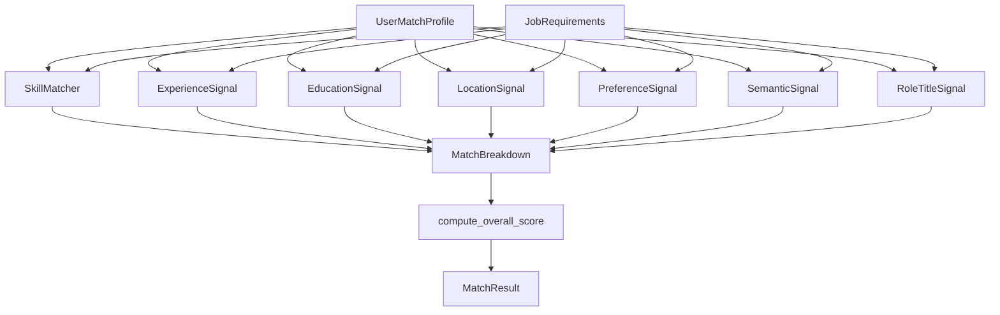
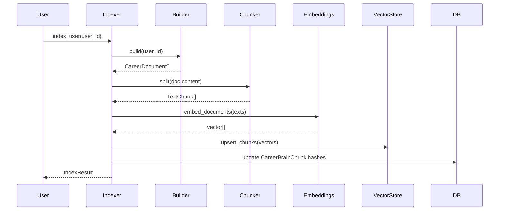
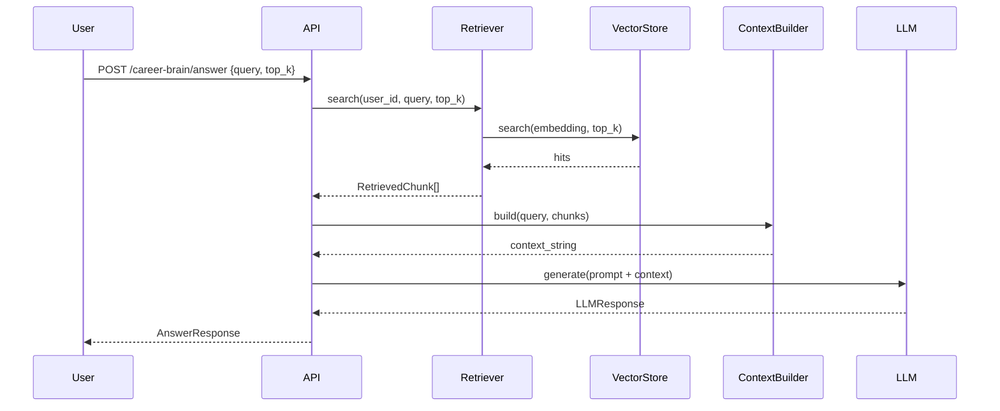
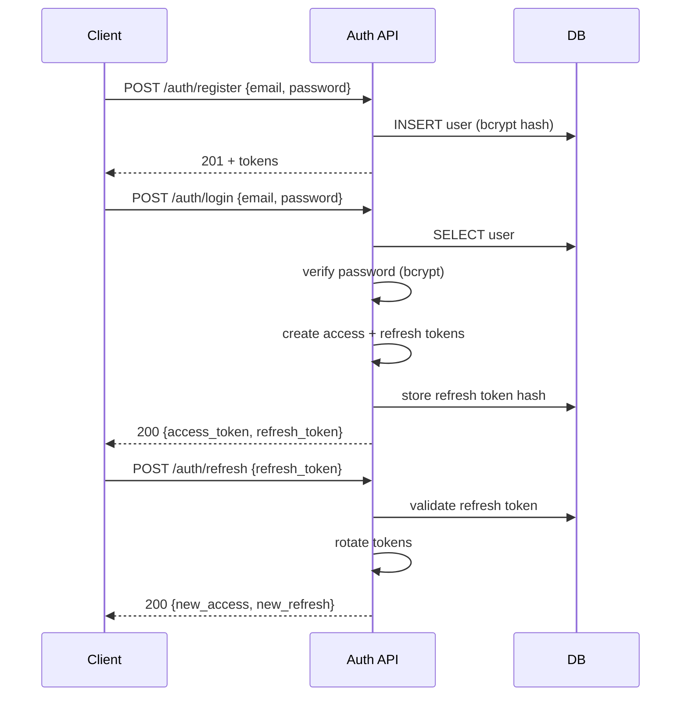

# CareerOS AI — Architecture Documentation

**Version:** 1.0  
**Date:** October 30, 2026

---

## 1. System Architecture

### 1.1 Overview
CareerOS AI follows a **modular monolith** architecture with clear separation between frontend (React SPA) and backend (FastAPI). The backend is organized into domain-driven services with well-defined boundaries.

### 1.2 Component Diagram

```mermaid
graph TB
    subgraph Client["Client Layer"]
        Browser[Web Browser]
        PWA[PWA / Mobile]
    end

    subgraph Frontend["Frontend (React 19)"]
        Router[React Router v7]
        Components[UI Components]
        State[Zustand + TanStack Query]
        Auth[AuthContext]
        APIClient[API Client Layer]
    end

    subgraph Backend["Backend (FastAPI)"]
        Middleware[Middleware Stack]
        AuthRouter[/auth]
        ProfileRouter[/profile, /education, /experience, /skills, /certifications]
        ResumeRouter[/resumes]
        JobRouter[/jobs, /sources, /matches]
        CareerBrainRouter[/career-brain]
        CRMRouter[/crm, /applications, /companies, /contacts]
    end

    subgraph Services["Domain Services"]
        AuthSvc[Auth Service]
        CareerSvc[Career Service]
        ResumeSvc[Resume Service]
        JobDiscoverySvc[Job Discovery Service]
        MatchEngineSvc[Match Engine Service]
        CareerBrainSvc[Career Brain Service]
        CRMSvc[CRM Service]
        SchedulerSvc[Scheduler Service]
    end

    subgraph Data["Data Access"]
        SQLAlchemy[SQLAlchemy ORM]
        Alembic[Alembic Migrations]
        VectorStore[Vector Store]
    end

    subgraph External["External Integrations"]
        Gemini[Google Gemini API]
        RemoteOK[Remote OK API]
        Himalayas[Himalayas API]
        GovPortals[Government Portals]
        PrivateBoards[Private Job Boards]
    end

    Browser --> Router
    PWA --> Router
    Router --> Components
    Components --> State
    State --> Auth
    Auth --> APIClient
    APIClient --> Middleware
    Middleware --> AuthRouter
    Middleware --> ProfileRouter
    Middleware --> ResumeRouter
    Middleware --> JobRouter
    Middleware --> CareerBrainRouter
    Middleware --> CRMRouter

    AuthRouter --> AuthSvc
    ProfileRouter --> CareerSvc
    ResumeRouter --> ResumeSvc
    JobRouter --> JobDiscoverySvc
    JobRouter --> MatchEngineSvc
    CareerBrainRouter --> CareerBrainSvc
    CRMRouter --> CRMSvc
    SchedulerSvc --> JobDiscoverySvc

    AuthSvc --> SQLAlchemy
    CareerSvc --> SQLAlchemy
    ResumeSvc --> SQLAlchemy
    JobDiscoverySvc --> SQLAlchemy
    JobDiscoverySvc --> VectorStore
    MatchEngineSvc --> SQLAlchemy
    CareerBrainSvc --> SQLAlchemy
    CareerBrainSvc --> VectorStore
    CRMSvc --> SQLAlchemy

    SQLAlchemy --> Alembic
    VectorStore -.-> SQLAlchemy

    JobDiscoverySvc --> RemoteOK
    JobDiscoverySvc --> Himalayas
    JobDiscoverySvc --> GovPortals
    JobDiscoverySvc --> PrivateBoards
    CareerBrainSvc --> Gemini
```

---

## 2. Backend Architecture

### 2.1 Layered Architecture

```
┌─────────────────────────────────────┐
│         API Routes (FastAPI)        │  ← Request/Response, Validation, Auth
├─────────────────────────────────────┤
│        Domain Services              │  ← Business Logic, Orchestration
├─────────────────────────────────────┤
│      Data Access (Repositories)     │  ← SQLAlchemy Models, Queries
├─────────────────────────────────────┤
│      Database (SQLite / PostgreSQL) │  ← Persistence
└─────────────────────────────────────┘
```

### 2.2 Service Boundaries

| Service | Responsibilities | Key Dependencies |
|---------|------------------|------------------|
| **Auth** | Registration, login, JWT, refresh, logout | `passlib`, `python-jose`, User model |
| **Career** | Profile, education, experience, skills, certs CRUD | User-owned models |
| **Resume** | Resume CRUD, sections, versions, import, ATS, tailoring | Resume models, Job model |
| **Job Discovery** | Multi-source fetch, normalize, dedup, schedule | Source adapters, Normalizer |
| **Match Engine** | 7-signal weighted scoring, ranking | User profile, Job model |
| **Career Brain** | Indexing, retrieval, RAG context, LLM answers | Vector store, Embeddings, LLM |
| **CRM** | Applications, pipeline, interviews, follow-ups | Application models |
| **Scheduler** | APScheduler jobs for periodic discovery | JobDiscoverySvc |

### 2.3 Key Design Patterns

1. **Repository Pattern**: Data access encapsulated in service methods
2. **Dependency Injection**: FastAPI `Depends` for DB sessions, current user
3. **Adapter Pattern**: `BaseJobSource` for pluggable job sources
4. **Strategy Pattern**: `EmbeddingProvider` for interchangeable embeddings
5. **Factory Pattern**: `SOURCE_REGISTRY` for source instantiation
5. **Observer Pattern**: Audit logging via `create_audit_log()`

---

## 3. Frontend Architecture

### 3.1 Component Hierarchy

```
App
├── AuthProvider (Context)
├── Routes
│   ├── Public: /login, /register
│   └── Protected (RequireAuth)
│       └── AppLayout
│           ├── Sidebar (Navigation)
│           ├── TopBar (Search, Theme, User Menu)
│           └── Outlet (Page Components)
│               ├── JobsPage
│               ├── JobDetailPage
│               ├── JobDiscoveryPage
│               ├── ResumesPage / ResumeEditorPage
│               ├── CareerBrainPage
│               ├── MatchesPage / MatchDetailPage
│               ├── ApplicationsPage / ApplicationDetailPage
│               ├── PipelinePage
│               ├── CRMDashboardPage / CRMWorkspacePage
│               ├── ProfilePage / CareerDataPage
│               └── SettingsPage
```

### 3.2 State Management

| State Type | Solution | Scope |
|------------|----------|-------|
| Server State | TanStack Query | Global (cache, dedup, retry) |
| Client State | Zustand | Auth, UI preferences |
| Form State | React Hook Form (where used) | Local |
| URL State | React Router | Navigation, filters |

### 3.3 API Client Layer

```typescript
// Base pattern in src/api/*.ts
const API_BASE = import.meta.env.VITE_API_URL || "http://localhost:8000/api/v1";

async function request<T>(path: string, init: RequestInit = {}): Promise<T> {
  const token = localStorage.getItem("careeros_token");
  const headers = {
    "Content-Type": "application/json",
    ...init.headers,
  };
  if (token) headers["Authorization"] = `Bearer ${token}`;
  
  const res = await fetch(`${API_BASE}${path}`, { ...init, headers });
  if (!res.ok) throw new Error(`API ${res.status}: ${await res.text()}`);
  return res.json();
}
```

---

## 4. Data Architecture

### 4.1 Database Schema (Core)

```mermaid
erDiagram
    USERS {
        uuid id PK
        string email UK
        string password_hash
        string full_name
        boolean is_active
        datetime created_at
        datetime updated_at
    }
    
    REFRESH_TOKENS {
        uuid id PK
        uuid user_id FK
        string token_hash
        datetime expires_at
        boolean revoked
        datetime created_at
    }

    CAREER_PROFILES {
        uuid id PK
        uuid user_id FK UK
        text summary
        string location
        integer years_experience
        jsonb target_roles
        jsonb preferred_cities
        string remote_preference
        jsonb employment_types
        string experience_level
    }

    JOBS {
        uuid id PK
        string source
        string source_job_id
        string source_url
        string title
        string company_name
        text description
        string eligibility  "eligible|ineligible|unknown"
        text eligibility_reason
        boolean is_remote
        string workplace_type
        string employment_type
        decimal salary_min
        decimal salary_max
        string country
        string city
        string province
        string content_hash UK
        string normalized_hash
    }

    CAREER_BRAIN_CHUNKS {
        uuid id PK
        uuid user_id FK
        string source_type
        uuid source_id
        string title
        text content
        string content_hash
        vector embedding  "pgvector or JSON"
    }

    APPLICATIONS {
        uuid id PK
        uuid user_id FK
        uuid job_id FK
        uuid company_id FK
        string status  "saved|applied|screening|interview|offer|rejected|..."
        string priority
        string source
        datetime applied_at
        datetime next_action_at
    }
```

### 4.2 Vector Storage Strategy

| Environment | Backend | Implementation |
|-------------|---------|----------------|
| Development | In-Memory | NumPy arrays, cosine similarity via dot product |
| Production | pgvector | HNSW index, `vector` column type |

**Embedding Provider Abstraction:**
```python
class EmbeddingProvider(ABC):
    @abstractmethod
    def embed_text(self, text: str) -> list[float]: ...
    @abstractmethod
    def embed_documents(self, texts: Sequence[str]) -> list[list[float]]: ...

# Implementations:
# - HashEmbeddingProvider (local, deterministic, no ML)
# - SentenceTransformerEmbeddingProvider (future, semantic)
```

---

## 5. Job Discovery Architecture

### 5.1 Source Adapter Pattern

```python
class BaseJobSource(ABC):
    source_id: str
    category: str  # government | private_board | company_career | remote
    integration_method: str  # api | feed | public_page | json_ld | unsupported
    
    @abstractmethod
    def fetch(self, *, max_results: int, timeout: float) -> list[RawJob]: ...
    
    # Built-in HTTP with retry/backoff
    def _get(self, url: str) -> httpx.Response: ...
```

### 5.2 Normalization Pipeline

```mermaid
graph LR
    RawJob[RawJob] --> Normalize[normalize()]
    Normalize --> Clean[Text Cleaning]
    Clean --> Detect[Detect City/Province/Workplace]
    Detect --> Hash[Content + Normalized Hash]
    Hash --> Dedup[Dedup by content_hash]
    Dedup --> Upsert[upsert_job()]
    Upsert --> DB[(Jobs Table)]
```

### 5.3 Eligibility Classification

```python
def _determine_eligibility(job_data: dict) -> tuple[str, str]:
    """
    Returns: (status, reason)
    Status: "eligible" | "ineligible" | "unknown"
    """
    # 1. Explicit country check
    # 2. Remote worldwide vs restricted
    # 3. Description keywords
    # 4. Default: unknown
```

---

## 6. Matching Engine Architecture

### 6.1 Signal Composition



### 6.2 Weighted Scoring

| Signal | Default Weight | Description |
|--------|---------------|-------------|
| Skills | 0.30 | Required/optional skill overlap |
| Experience | 0.15 | Years vs job min/max |
| Education | 0.10 | Degree level match |
| Location | 0.15 | City/province/remote preference |
| Preferences | 0.15 | Employment type, salary, sector |
| Semantic | 0.10 | Career Brain vector similarity |
| Role/Title | 0.05 | Title keyword overlap |

**Missing Data Handling**: Unavailable signals get neutral (0.5) weight redistributed.

---

## 7. Career Brain RAG Architecture

### 7.1 Indexing Pipeline



### 7.2 Retrieval + Generation



### 7.3 Fallback Strategy

| Scenario | Behavior |
|----------|----------|
| No `GEMINI_API_KEY` | Mock provider → deterministic context summary |
| LLM error | Error fallback → context + warning |
| No chunks found | "No relevant career information found" |
| Low confidence | Warning in response |

---

## 8. Security Architecture

### 8.1 Authentication Flow



### 8.2 Authorization Model

| Resource | Owner Check | Cross-User Access |
|----------|-------------|-------------------|
| Profile, Education, etc. | `user_id == current_user.id` | 404 |
| Resumes | `resume.user_id == current_user.id` | 404 |
| Jobs | Public (global) | N/A |
| Saved Jobs | `saved.user_id == current_user.id` | 404 |
| Applications | `app.user_id == current_user.id` | 404 |
| Career Brain | `chunk.user_id == current_user.id` | 404 |

### 8.3 Security Headers & Middleware

- **CORS**: Configured origins only
- **Rate Limiting**: Auth endpoints (60/min/IP)
- **Request ID**: `X-Request-ID` for tracing
- **Error Handling**: Sanitized responses, detailed logs

---

## 9. Deployment Architecture

### 9.1 Development

```
┌─────────────┐     ┌─────────────┐
│  Frontend   │     │  Backend    │
│  (Vite dev) │────▶│  (Uvicorn)  │
│  :5173      │     │  :8000      │
└─────────────┘     └─────────────┘
                           │
                    ┌──────┴──────┐
                    │  SQLite     │
                    │  careeros.db│
                    └─────────────┘
```

### 9.2 Production (Recommended)

```
┌─────────────┐     ┌─────────────┐     ┌─────────────┐
│   Nginx     │     │  Frontend   │     │  Backend    │
│  (SSL,      │────▶│  (Static    │     │  (Gunicorn/ │
│  Proxy,     │     │  Files)     │     │  Uvicorn    │
│  Static)    │     │             │     │  Workers)   │
└─────────────┘     └─────────────┘     └─────────────┘
                           │                   │
                    ┌──────┴──────┐     ┌──────┴──────┐
                    │  PostgreSQL │     │   Redis     │
                    │  + pgvector │     │  (Queue,    │
                    │             │     │   Cache)    │
                    └─────────────┘     └─────────────┘
```

### 9.3 Environment Variables

| Variable | Required | Description |
|----------|----------|-------------|
| `DATABASE_URL` | Yes | PostgreSQL connection string |
| `SECRET_KEY` | Yes | JWT signing key (32+ chars) |
| `GEMINI_API_KEY` | No | Google Gemini API key |
| `FRONTEND_URL` | Yes | CORS origin |
| `JWT_ALGORITHM` | No | Default: HS256 |
| `ACCESS_TOKEN_EXPIRE_MINUTES` | No | Default: 30 |

---

## 10. Observability

### 10.1 Logging
- Structured JSON logging via `structlog` (configured in `app.core.logging`)
- Request ID correlation via middleware
- Audit logs for all mutating operations

### 10.2 Metrics (Future)
- Prometheus metrics endpoint
- Key metrics: request latency, error rate, queue depth, discovery success rate

### 10.3 Error Tracking (Future)
- Sentry integration for exception capture
- User feedback on errors

---

## 11. Scalability Considerations

| Component | Current | Scaling Path |
|-----------|---------|--------------|
| Job Discovery | Sync, in-process | Redis queue + Celery workers |
| Vector Search | In-memory / pgvector | Dedicated vector DB (Pinecone, Weaviate) |
| LLM Calls | Direct API | Async queue + caching |
| Database | Single PostgreSQL | Read replicas, connection pooling |
| Frontend | Static files | CDN + edge caching |