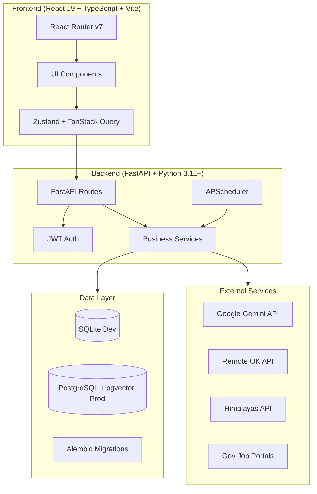
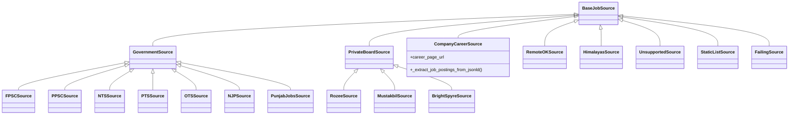
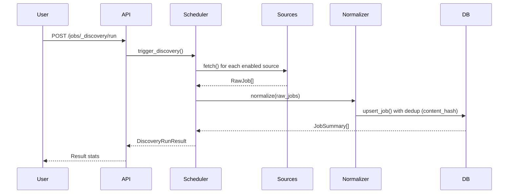
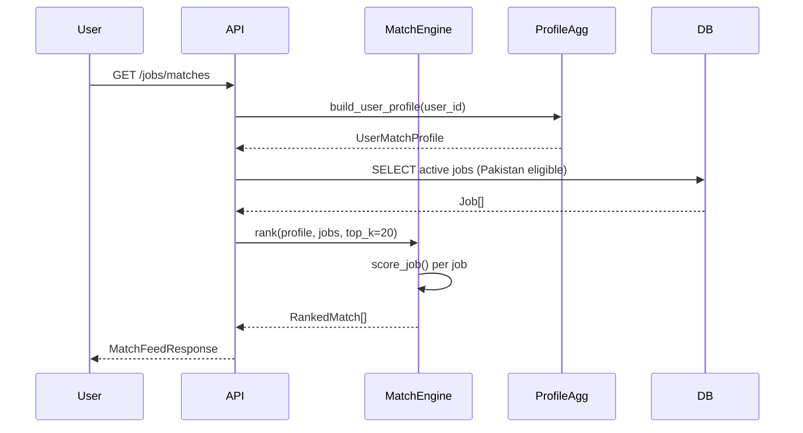
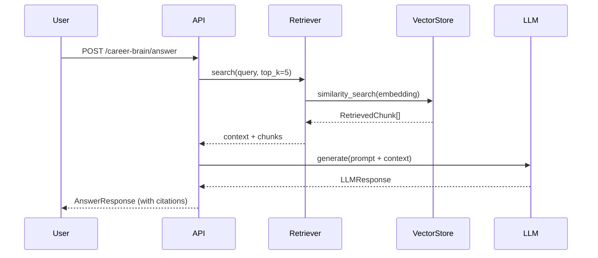

# CareerOS AI — Software Design Description (SDD)

**Version:** 1.0  
**Date:** October 30, 2026

---

## 1. Architecture Overview

### 1.1 High-Level Architecture



### 1.2 Technology Stack

| Layer | Technology | Version |
|-------|------------|---------|
| Frontend Framework | React | 19.3.0 |
| Language | TypeScript | 5.9.3 |
| Build Tool | Vite | 8.2.2 |
| Styling | Tailwind CSS | 3.4.17 |
| State Management | Zustand | 5.0.15 |
| Data Fetching | TanStack Query | 5.102.8 |
| Routing | React Router | 7.18.3 |
| UI Primitives | Radix UI | 1.1.23 |
| Icons | Lucide React | 1.46.0 |
| Backend Framework | FastAPI | 0.110+ |
| Language | Python | 3.11+ |
| ORM | SQLAlchemy | 2.0+ |
| Migrations | Alembic | 1.13+ |
| Database (Dev) | SQLite | 3.x |
| Database (Prod) | PostgreSQL + pgvector | 15+ |
| Auth | python-jose + passlib | 3.4+ / 1.7+ |
| Scheduler | APScheduler | 3.10+ |
| AI Provider | Google Generative AI | 0.8.6+ |

---

## 2. Component Design

### 2.1 Frontend Components

#### 2.1.1 Layout Components
- **AppLayout**: Root layout with sidebar, topbar, outlet
- **Sidebar**: Collapsible navigation with sections (Core, Career Intelligence, Applications, Profile)
- **TopBar**: Sticky header with global search, theme toggle, notifications, user menu
- **PageHeader**: Consistent page titles with breadcrumbs, actions
- **MobileNav**: Bottom navigation for mobile viewports

#### 2.1.2 UI Components (shadcn-inspired)
- **Button**: Variants (primary, secondary, ghost, danger, outline, success), sizes, loading state, icons
- **Card**: Default, hover, glass variants with header/content/footer
- **Input**: Label, error, helper text, left/right icons
- **Badge**: Variants (default, primary, success, warning, error, info, neutral), sizes, dot indicator
- **EmptyState**: Icon, title, description, action
- **ErrorState**: Message, retry action, home link
- **Skeleton**: Text, card, avatar, table variants
- **PageHeader**: Breadcrumbs, title, subtitle, description, actions

#### 2.1.3 Page Components
- **JobsPage**: Search, filters, job cards with save/match actions, pagination
- **JobDetailPage**: Full job description, match link, application tracking
- **JobDiscoveryPage**: Source health, configured sources, discovery history
- **ResumeStudio**: Resume list, editor, ATS analysis, tailoring, import/export
- **CareerBrainPage**: Index, search, context, AI answer generation
- **MatchesPage**: Ranked job matches with scores
- **ApplicationsPage**: List with filters, status badges
- **PipelinePage**: Kanban board with drag-drop (future)
- **CRMDashboardPage**: Stats cards, pipeline, funnel, upcoming interviews
- **ProfilePage**: Career profile CRUD tabs

### 2.2 Backend Services

#### 2.2.1 Core Services
| Service | Responsibility |
|---------|----------------|
| `auth` | JWT creation/validation, password hashing, token refresh |
| `career` | Profile, education, experience, skills, certifications CRUD |
| `resume` | Resume CRUD, sections, versions, import, ATS, tailoring |
| `job_discovery` | Multi-source orchestration, normalization, dedup, scheduling |
| `match_engine` | Explainable weighted scoring across 7 signals |
| `career_brain` | Indexing, retrieval, RAG context, LLM answer generation |
| `crm` | Applications, companies, contacts, interviews, follow-ups |
| `scheduler` | APScheduler for periodic job discovery |

#### 2.2.2 Job Source Adapters


**Eligibility Determination Logic:**
```python
def _determine_eligibility(job_data: dict) -> tuple[str, str]:
    # 1. Check explicit country restrictions
    # 2. Check workplace type (remote worldwide vs restricted)
    # 3. Check description for Pakistan-specific language
    # 4. Return: "eligible" | "ineligible" | "unknown" with reason
```

### 2.3 API Design

#### 2.3.1 Route Structure
```
/api/v1/
├── /auth
│   ├── POST /register
│   ├── POST /login
│   ├── POST /refresh
│   ├── GET  /me
│   └── POST /logout
├── /profile, /education, /experience, /skills, /certifications
├── /career-brain
│   ├── POST /index
│   ├── POST /search
│   ├── POST /context
│   └── POST /answer
├── /jobs
│   ├── GET  /jobs (search/filter)
│   ├── GET  /jobs/{id}
│   ├── POST /jobs/{id}/save
│   ├── DELETE /jobs/{id}/save
│   ├── GET  /jobs/saved
│   ├── POST /jobs/_discovery/run
│   ├── GET  /sources
│   ├── GET  /sources/health
│   └── GET  /jobs/discovery/runs
├── /jobs/matches
│   ├── GET  /jobs/matches (feed)
│   └── GET  /jobs/{id}/match
├── /resumes
│   ├── CRUD + sections + versions
│   ├── POST /ats/analyze
│   ├── POST /tailor
│   ├── POST /{id}/import/text|file
│   └── POST /build-from-profile
└── /crm
    ├── /applications (CRUD + transitions + timeline)
    ├── /companies, /contacts
    ├── /interviews, /follow-ups, /offers, /rejections
    └── /dashboard, /pipeline, /analytics
```

---

## 3. Database Design

### 3.1 Entity Relationship Diagram

```mermaid
erDiagram
    USERS ||--o{ REFRESH_TOKENS : has
    USERS ||--o{ CAREER_PROFILES : has
    USERS ||--o{ EDUCATIONS : has
    USERS ||--o{ WORK_EXPERIENCES : has
    USERS ||--o{ SKILLS : has
    USERS ||--o{ CERTIFICATIONS : has
    USERS ||--o{ RESUMES : owns
    USERS ||--o{ CAREER_BRAIN_CHUNKS : owns
    USERS ||--o{ USER_JOB_PREFERENCES : has
    USERS ||--o{ USER_SAVED_JOBS : saves
    USERS ||--o{ APPLICATIONS : owns
    USERS ||--o{ COMPANIES : links
    USERS ||--o{ CONTACTS : owns
    USERS ||--o{ INTERVIEWS : owns
    USERS ||--o{ FOLLOW_UPS : owns
    USERS ||--o{ AUDIT_LOGS : generates

    RESUMES ||--o{ RESUME_SECTIONS : contains
    RESUMES ||--o{ RESUMES : versions (parent)

    JOBS ||--o{ USER_SAVED_JOBS : saved_by
    JOBS ||--o{ APPLICATIONS : applied_to
    JOBS ||--o{ JOB_DISCOVERY_RUNS : discovered_in
    JOBS ||--o{ JOB_EXTERNAL_REFS : referenced_by
    JOB_SOURCES ||--o{ JOBS : sources
    JOB_SOURCES ||--o{ JOB_DISCOVERY_RUNS : runs

    APPLICATIONS ||--o{ APPLICATION_ACTIVITIES : has
    APPLICATIONS ||--o{ APPLICATION_DOCUMENTS : has
    APPLICATIONS ||--o{ INTERVIEWS : has
    APPLICATIONS ||--o{ FOLLOW_UPS : has
    APPLICATIONS ||--o{ OFFERS : has
    APPLICATIONS ||--o{ REJECTIONS : has
    APPLICATIONS ||--o{ RECOMMENDATIONS : has

    COMPANIES ||--o{ USER_COMPANY_LINKS : linked_to
    COMPANIES ||--o{ CONTACTS : employs
    COMPANIES ||--o{ APPLICATION_COMPANIES : referenced_in
```

### 3.2 Key Tables

| Table | Purpose | Key Columns |
|-------|---------|-------------|
| `users` | Authentication | id, email, password_hash, full_name, is_active |
| `career_profiles` | User career summary | user_id, summary, location, years_experience |
| `educations` | Education history | user_id, degree, institution, dates, gpa |
| `work_experiences` | Work history | user_id, title, company, dates, achievements |
| `skills` | Skill inventory | user_id, name, category, proficiency, years |
| `certifications` | Certificates | user_id, name, issuer, dates, credential_id |
| `resumes` | Resume documents | user_id, name, type, status, structured_data |
| `resume_sections` | Resume sections | resume_id, type, title, content, order |
| `jobs` | Normalized job listings | source, source_job_id, title, company, eligibility, etc. |
| `job_sources` | Source configuration | id, name, category, enabled, health fields |
| `user_saved_jobs` | User bookmarks | user_id, job_id, notes |
| `applications` | CRM applications | user_id, job_id, company_id, status, priority |
| `career_brain_chunks` | RAG chunks | user_id, source_type, content, embedding |

### 3.3 Vector Storage
- **Development**: In-memory NumPy cosine similarity
- **Production**: PostgreSQL `pgvector` with HNSW index
- **Embedding Dimension**: 384 (local hash) or 768+ (sentence-transformers)
- **Chunking**: 500 tokens, 50 overlap, max 8 chunks/doc

---

## 4. Security Design

### 4.1 Authentication
- **JWT**: HS256, 30-min access tokens, 7-day refresh tokens with rotation
- **Passwords**: bcrypt with cost factor 12
- **Token Storage**: HttpOnly cookies (production) / localStorage (dev)

### 4.2 Authorization
- All routes (except auth, health) require `Authorization: Bearer <token>`
- User-scoped queries filter by `user_id` at repository level
- Cross-user access returns 404 (not 403) to prevent enumeration

### 4.3 Input Validation
- Pydantic v2 schemas on all request bodies
- File upload: extension allowlist (pdf, docx, txt), 10MB max, path traversal check
- SQL injection prevention via SQLAlchemy ORM parameterization

### 4.4 Rate Limiting
- Auth endpoints: 60 req/min per IP (in-memory)
- API endpoints: configurable per-user limits (future: Redis)

### 4.5 Secrets Management
- `.env` file for local development (never committed)
- Environment variables for production
- No API keys in logs or error responses

---

## 5. Data Flows

### 5.1 Job Discovery Flow


### 5.2 Job Matching Flow


### 5.3 Career Brain RAG Flow


---

## 6. Integration Architecture

### 6.1 External Job Sources

| Source | Method | Auth | Rate Limit | Status |
|--------|--------|------|------------|--------|
| Remote OK | REST API | None | 60/min | Implemented |
| Himalayas | REST API | None | 60/min | Implemented |
| Rozee.pk | HTML Parse | None | 1 req/sec | Implemented (unverified) |
| Mustakbil | HTML Parse | None | 1 req/sec | Implemented (unverified) |
| BrightSpyre | HTML Parse | None | 1 req/sec | Implemented (unverified) |
| FPSC/PPSC/NTS/etc | HTML Parse | None | 1 req/sec | Implemented (unverified) |
| Company Career | JSON-LD Parse | None | 1 req/sec | Template |
| LinkedIn/Indeed | Unsupported | N/A | N/A | Blocked |

### 6.2 AI Provider (Gemini)
- **Model**: `gemini-1.5-flash` (configurable)
- **Temperature**: 0.3 (configurable)
- **Max Tokens**: 4096 (configurable)
- **Structured Output**: JSON schema validation via Pydantic
- **Fallback**: Mock provider when `GEMINI_API_KEY` not set

---

## 7. Deployment Considerations

### 7.1 Development
```bash
# Backend
cd careeros/backend
python -m venv .venv
source .venv/bin/activate
pip install -e .
python -m alembic upgrade head
python -m uvicorn app.main:app --reload

# Frontend
cd careeros/frontend
npm install
npm run dev
```

### 7.2 Production Checklist
- [ ] PostgreSQL + pgvector database
- [ ] `DATABASE_URL` with connection pooling
- [ ] Strong `SECRET_KEY` (32+ chars)
- [ ] `GEMINI_API_KEY` for AI features
- [ ] CORS origins configured
- [ ] HTTPS with reverse proxy (nginx)
- [ ] Process manager (systemd/supervisord)
- [ ] Log aggregation
- [ ] Backup strategy for database

---

## 8. Testing Strategy

| Level | Tool | Coverage |
|-------|------|----------|
| Unit (Backend) | pytest | 493 tests passing |
| Unit (Frontend) | Vitest + Testing Library | 4 tests |
| Integration | FastAPI TestClient | Auth, Jobs, CRM, Resume |
| E2E | Playwright | Configured, not implemented |

---

## 9. Future Architecture Evolution

1. **Message Queue**: Redis + Celery/RQ for background jobs
2. **Caching**: Redis for rate limits, session cache
3. **Monitoring**: OpenTelemetry + Sentry
4. **Multi-tenancy**: Organization/workspace model
5. **Event Sourcing**: Audit log → event store
6. **Real-time**: WebSockets for notifications